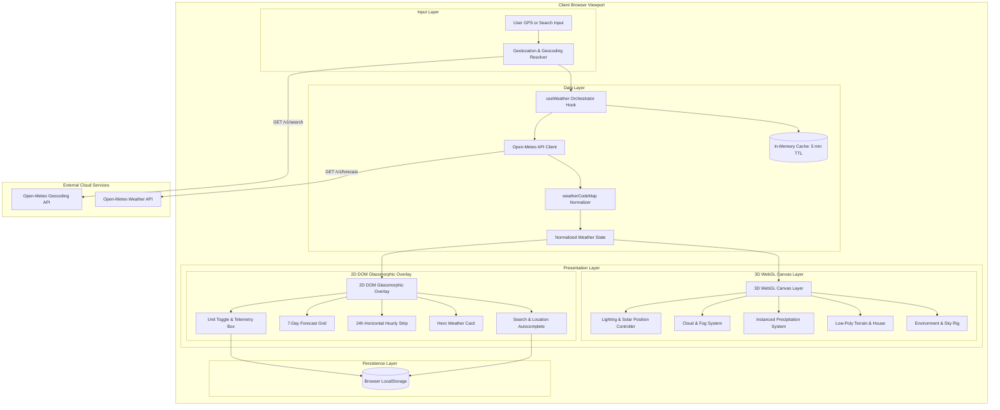

# System Architecture Document

## Project: 3D Weather Web App
**Status:** In Review  
**Version:** 1.0.0  
**Target Platform:** Modern Web Browsers (WebGL 2.0 / WebGPU ready)  

---

## 1. Technology Stack and Rationale

| Layer | Technology | Version | One-Line Rationale |
|---|---|---|---|
| **Core Framework** | React | `^18.3.1` | Declarative component model and reactive state coordination between UI and Canvas. |
| **Build Tool** | Vite | `^5.4.0` | Sub-second Hot Module Replacement (HMR) and optimized Rollup production tree-shaking. |
| **Language** | TypeScript | `^5.5.0` | Compile-time validation for Open-Meteo payloads, coordinate vectors, and 3D props. |
| **3D Rendering** | Three.js | `^0.168.0` | Standard low-level WebGL graphics engine with mature shader and matrix utilities. |
| **React 3D Bridge** | `@react-three/fiber` | `^8.17.0` | Reconciles Three.js scene graphs directly into React component lifecycles. |
| **3D Helpers** | `@react-three/drei` | `^9.112.0` | Battle-tested utilities for OrbitControls, Sky shaders, and instanced mesh management. |
| **Styling** | Tailwind CSS | `^3.4.0` | Utility-first CSS engine for rapid glassmorphic styling without runtime CSS-in-JS overhead. |
| **UI Motion** | Framer Motion | `^11.5.0` | Physics-driven transitions for card enter/exit states and layout morphing. |
| **Iconography** | Lucide React | `^0.440.0` | Clean, accessible SVG icons with zero runtime styling dependencies. |
| **Data Provider** | Open-Meteo API | v1 REST | Zero-key meteorological API delivering current, hourly, daily, and geocoding endpoints. |

---

## 2. High-Level System Architecture



---

## 3. Directory Structure and Architectural Boundaries

```
weather-app/
├── docs/                      # 8 pre-code architecture and specification docs
│   ├── PRD.md
│   ├── DESIGN_SYSTEM.md
│   ├── ARCHITECTURE.md
│   └── ...
├── public/                    # Static assets (favicons, manifest, low-poly assets)
├── src/
│   ├── assets/                # Static SVGs and textures (if required)
│   ├── components/
│   │   ├── scene/             # Strictly 3D WebGL / R3F components
│   │   │   ├── WeatherCanvas.tsx     # Canvas container, Camera, OrbitControls
│   │   │   ├── LowPolyLandscape.tsx  # Hills, house, trees terrain geometry
│   │   │   ├── SkyEnvironment.tsx    # Sun, moon, stars, ambient sky dome
│   │   │   ├── RainParticles.tsx     # Instanced precipitation mesh
│   │   │   ├── SnowParticles.tsx     # Instanced snow mesh with sway
│   │   │   ├── CloudLayers.tsx       # Layered cloud meshes with opacity
│   │   │   ├── LightningEffect.tsx   # Point light pulse controller
│   │   │   └── FogController.tsx     # Scene fog lerper
│   │   └── ui/                # Strictly HTML / Tailwind / Framer Motion components
│   │       ├── Header.tsx            # App bar, search trigger, unit toggle
│   │       ├── SearchBar.tsx         # Autocomplete input and dropdown
│   │       ├── HeroWeatherCard.tsx   # Current temp, conditions, high/low
│   │       ├── MetricsGrid.tsx       # Wind, humidity, UV index, feels-like
│   │       ├── HourlyForecastStrip.tsx # Horizontal 24h cards
│   │       ├── DailyForecastList.tsx # 7-day outlook list
│   │       ├── ErrorBoundary.tsx     # Fallback UI on runtime crash
│   │       └── LoadingSkeleton.tsx   # Glassmorphic skeleton loader
│   ├── constants/             # Immutable application constants
│   │   ├── config.ts          # Cache TTL, default city coordinates, API endpoints
│   │   └── weatherCodes.ts    # WMO code definitions and severity maps
│   ├── hooks/                 # Custom React hooks (Logic & Subscription)
│   │   ├── useWeather.ts      # Fetching, normalization, 5-min caching
│   │   ├── useGeocoding.ts    # City autocomplete with debounce
│   │   ├── useGeolocation.ts  # Browser GPS with timeout fallback
│   │   └── usePreferences.ts  # LocalStorage sync for units and recent cities
│   ├── types/                 # Shared TypeScript interfaces
│   │   ├── weather.ts         # Normalized weather models and raw Open-Meteo types
│   │   ├── geo.ts             # Geocoding search result schemas
│   │   └── scene.ts           # 3D parameter interfaces
│   ├── utils/                 # Pure functions (Zero React / Three.js dependency)
│   │   ├── weatherCodeMap.ts  # WMO code to condition category mapper
│   │   ├── solarPosition.ts   # Solar elevation and azimuth calculations
│   │   ├── unitConversion.ts  # Celsius to Fahrenheit, km/h to mph
│   │   └── cache.ts           # In-memory LRU or Map-based cache utility
│   ├── App.tsx                # Top-level composition shell
│   ├── main.tsx               # React DOM entrypoint
│   └── index.css              # Tailwind directives and base font rules
├── index.html                 # HTML shell with meta tags and title
├── package.json               # Node dependencies and build scripts
├── tailwind.config.js         # Custom design tokens, glass utilities
├── tsconfig.json              # Strict TypeScript compiler options
└── vite.config.ts             # Vite build plugins
```

### Strict Boundary Rules
1. **Scene Isolation:** Files within `src/components/scene/` must never import or render standard HTML DOM tags (such as `<div>`, `<button>`, `<input>`). They must only emit Three.js primitives and R3F components.
2. **UI Isolation:** Files within `src/components/ui/` must never directly instantiate Three.js objects or manipulate WebGL contexts. They interact with the 3D scene purely through shared state props.
3. **Pure Logic Isolation:** Files within `src/utils/` must be 100% deterministic pure functions. They must not use React hooks, browser DOM APIs, or global state.
4. **No Per-Frame Allocations:** Inside `useFrame` render loops in `components/scene/`, no `new THREE.Vector3()`, `new THREE.Color()`, or array allocations are permitted. Scratch objects must be allocated once via `useRef` or outside the hook.

---

## 4. End-to-End Request and State Lifecycle Flow

The following lifecycle traces a complete user interaction: searching for "Tokyo" and updating both the 3D world and the UI overlay.

```
[User types "Tokyo" in SearchBar]
        │
        ▼ (300ms debounce timer)
[useGeocoding triggers fetch: https://geocoding-api.open-meteo.com/v1/search?name=Tokyo&count=5]
        │
        ▼
[Results parsed: Tokyo, Japan (lat: 35.6895, lon: 139.6917)]
        │
        ▼
[User selects Tokyo from Autocomplete list]
        │
        ▼
[useWeather executes fetchWeatherData(35.6895, 139.6917)]
        │
        ├── Check Cache: Key "weather_35.6895_139.6917"
        │     └── Cache Miss: Construct HTTP Request
        ▼
[Fetch: https://api.open-meteo.com/v1/forecast?latitude=35.6895&longitude=139.6917&current=...&hourly=...&daily=...]
        │
        ▼
[Response received (Status 200 OK)]
        │
        ├── Store payload in memory cache with Timestamp + 300,000ms
        │
        ▼
[weatherCodeMap parses WMO code -> Maps to "rain" condition category]
[solarPosition calculates sun angle based on sunrise, sunset, and current local time]
        │
        ▼
[Normalized State Dispatched to React Context / App State]
        │
        ├─────────────────────────────────────────┐
        ▼                                         ▼
[2D UI Overlay Updates via Framer Motion]    [3D Scene Transition Initiated]
 - Temperature updates (e.g. 19°C)           - useFrame begins smooth lerp (1.2s duration)
 - Hourly forecast strip re-renders          - Sky color lerps toward overcast slate
 - Weekly cards update                       - Sun position transitions below horizon
 - Badge updates to "Light Rain"             - RainParticles instanced count increases to 1,200
                                             - Fog density lerps from 0.002 to 0.015
                                             - Wind velocity drives particle drift vector
```

---

## 5. Environment Configurations

| Environment | Host / Runtime | Configuration | Characteristics |
|---|---|---|---|
| **Development** | Local Node.js 20+ / Vite | `http://localhost:5100` | Source maps enabled, hot module reloading, verbose console warnings for WebGL errors. |
| **Staging / Preview** | Vercel / Cloudflare Pages | Edge preview URLs | Production minification, asset hash cache busting, automated branch preview builds. |
| **Production** | Custom Domain via Vercel / CDN | `https://[custom-domain]` | Strict HTTPS, Brotli/Gzip compression, immutable static asset caching (1 year), zero console logs. |

---

## 6. Architecture Decision Log (ADRs)

### ADR-01: Open-Meteo REST API as Meteorological Engine
- **Context:** Need global real-time, hourly, and 7-day weather forecasts without paywalls or friction.
- **Decision:** Use Open-Meteo API.
- **Rationale:** Requires no API key, provides generous rate limits for non-commercial client-side use, delivers raw WMO weather codes, and includes a high-accuracy geocoding endpoint in the same ecosystem.

### ADR-02: React Three Fiber (R3F) for Scene Composition
- **Context:** Need to synchronize React UI state (temperature, weather conditions, time of day) with a 3D WebGL scene.
- **Decision:** Adopt `@react-three/fiber` and `@react-three/drei`.
- **Rationale:** Treats 3D meshes as native React components with declarative props, automatic canvas resizing, and unified lifecycle management, avoiding fragile manual Three.js render loops.

### ADR-03: InstancedMesh for Weather Particle Systems
- **Context:** Weather effects (rain, snow) require 1,000 to 3,000 particles moving simultaneously at 60 FPS.
- **Decision:** Use `THREE.InstancedMesh` with pre-allocated Float32Array transformation matrices.
- **Rationale:** Renders thousands of particles in a single GPU draw call. Eliminates per-particle mesh nodes, reducing memory overhead and preventing CPU bottlenecks.

### ADR-04: Client-Side In-Memory Cache (5-Minute TTL)
- **Context:** Users frequently re-select cities or trigger component re-mounts.
- **Decision:** Implement a lightweight in-memory cache keyed by `lat_lon_units` with a 5-minute expiration time.
- **Rationale:** Prevents duplicate network requests within short timeframes, ensuring instantaneous UI response when switching back to a recent city while respecting Open-Meteo server capacity.

### ADR-05: Single-Page Viewport with Stacked Z-Layers
- **Context:** Visual design requires seamless integration between the 3D landscape and the data dashboard.
- **Decision:** Full-screen fixed canvas (`z-0`) overlaid with a pointer-events-pass-through DOM container (`z-10`).
- **Rationale:** Allows mouse wheel and gentle dragging to reach OrbitControls on empty canvas spaces while retaining crisp interactive focus on UI cards (`pointer-events-auto`).

---

## 7. System Boundaries and Operational Constraints
1. **Network Failure Resilience:** If the Open-Meteo API is unreachable or times out (8-second threshold), the application displays a non-modal warning banner and retains the last successfully fetched weather state.
2. **Mobile Hardware Scaling:** On viewports under 768px wide or devices reporting `navigator.hardwareConcurrency <= 4`, shadow maps are disabled (`gl.shadowMap.enabled = false`) and particle counts are capped at 500 units.
3. **Data Freshness Boundary:** Data older than 5 minutes is marked stale and refetched automatically when the window regains focus.

---

*End of Document 3 (docs/ARCHITECTURE.md). Awaiting user review and explicit approval.*
